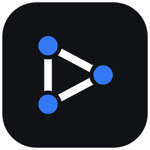
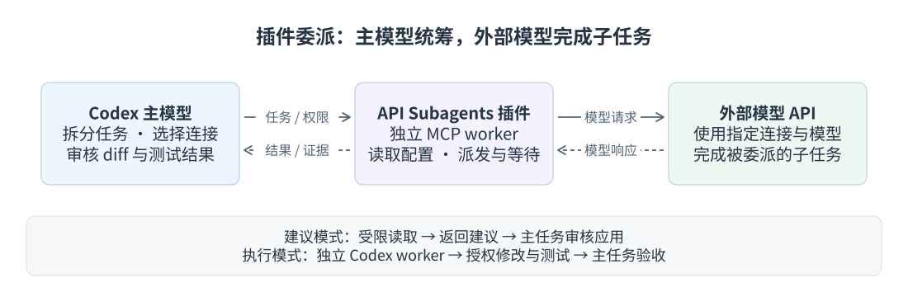
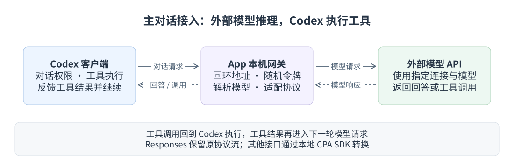

<div align="center">



# API Subagents

**把你的模型 API 接入 Codex。**

一个 Windows 桌面工作台，统一管理模型连接：<br>
把独立任务交给外部模型，或让外部模型直接处理 Codex 主对话。


[**下载 Windows 版**](https://github.com/U109/api-subagents/releases/latest) · [使用指南](docs/usage.md) · [更新记录](docs/releases/release-notes.md) · [反馈问题](https://github.com/U109/api-subagents/issues)

</div>

> 本页介绍当前源码，可能包含尚未发布的功能。安装包的功能与变化，以对应 [Release](https://github.com/U109/api-subagents/releases) 的说明为准。

## 两种使用方式

| | 插件委派 | 主对话接入 |
| --- | --- | --- |
| **适合什么** | 保留 Codex 主模型，把独立任务分出去 | 让自己的外部模型处理主对话 |
| **谁处理主对话** | 原来的 Codex 主模型 | 你选定的外部模型 |
| **外部模型如何工作** | 返回修改建议，或在授权后执行和测试 | 在 Codex 中回答、调用工具并继续工作 |
| **从哪里开启** | App → 插件管理 → 安装到 Codex | 接入配置 → 保存并启用／主对话接入开关 |
| **App 是否需要常开** | 不需要，安装并保存配置后可退出 | 需要，App 提供本机转发网关 |

外部 API 按你使用的服务计费；**插件委派仍需要 Codex 主模型参与，不能绕过它的额度**，也不保证总 token 用量一定更少。本项目不提供模型额度，不读取 Codex 套餐余额。

## 工作原理

App 负责维护本机连接：**API 地址、凭据、已选模型和默认值**。插件委派使用连接中的模型；主对话接入通过独立的「接入配置」组合连接并选择模型子集，不改动共享连接的模型选择。

### 1. 插件委派：主模型负责统筹，外部模型完成子任务



1. 你说明任务范围、允许使用的连接，以及是否允许直接修改文件。
2. Codex 主模型通过插件提交任务；独立 MCP worker 读取本机连接配置，调用指定的外部模型。
3. **建议模式**只允许受限读取和提出修改建议，不直接执行命令或写文件；主任务审核后再应用。
4. **执行模式**启动独立的 Codex worker。外部模型提出工具调用，由 worker 在授权范围内修改指定工作区、执行命令和测试。
5. 插件返回建议或执行证据；主任务检查实际 diff、命令退出码和测试结果，再继续主任务。

这条路径不替换主对话模型，也不改写主对话的提供商配置。插件安装并保存连接后，App 可以关闭；执行模式仍需本机可用的 Codex CLI。等待超时不会重启任务，应继续等待同一个 `task_id`。

### 2. 主对话接入：Codex 执行工具，外部模型负责推理



1. 在「接入配置」组合连接并勾选模型，点击「保存并启用」。App 暂存原有 Codex 设置，只生成该配置范围的模型目录；提供商显示名称为 **API Subagents**。
2. 重启 Codex 后，客户端把对话请求发给 App 的本机网关。网关根据所选模型找到对应连接，解析为真实上游模型 ID，并使用该连接的凭据。
3. **Responses 接口**保留原协议和流式事件；**Chat Completions、Claude、Gemini**由本地 CPA SDK 做协议转换，不另换模型或服务。
4. 模型返回回答或工具调用。**工具仍由 Codex 在当前权限范围内执行**，结果进入下一轮模型请求；App 负责转发，不替代 Codex 的工具执行和授权。
5. 关闭接入或正常退出 App 时恢复原配置；异常退出后，下次启动会尝试恢复。发生配置冲突时保留备份，不强行覆盖。

网关只监听回环地址，使用随机令牌鉴权，不向上游转发 Codex 登录凭据。使用期间必须保持 App 运行；开启、关闭或修改模型目录后需重启 Codex。[配置恢复与排错 →](docs/usage.md#挟持模式)

### 3. 一个连接如何对应多个模型

下面是结构示例，不是可直接使用的模型 ID 或连接配置：

```text
连接「编码助手」：共用一份 API 地址与 Key
├─ 模型 A（星标默认） → 普通编码任务
├─ 模型 B             → 分析或快速处理
└─ 生图模型            → 通过插件 generate_image 调用
```

插件可以按任务选择连接及其中的任意已选模型，省略模型时使用星标默认值；主对话接入则把具体模型列为 **连接名 · 模型名称**。选择具体模型后，请求固定映射到它的上游 ID，不因 App 默认值改变而偷偷换模型。生图模型不应设为主对话模型。[生图参数与限制 →](docs/usage.md#在-codex-对话中生成图片)

两张原理图均为可编辑矢量图，不使用页面截图。编辑源：[插件委派](docs/images/plugin-delegation-flow.excalidraw) · [主对话接入](docs/images/main-chat-flow.excalidraw)，可拖入 Excalidraw 打开。

## 目前支持的功能

| 功能 | 可以做什么 | 需要注意 |
| --- | --- | --- |
| **连接管理** | 添加、重命名、复制、删除连接，设置地址、Key、接口和任务分工 | 配置保存在本机；环境变量 Key 需在实际请求进程中可用 |
| **多模型配置** | 刷新目录、搜索勾选、手动添加 ID，设置显示名称和星标默认模型 | 每个连接最多 33 个已选模型；修改目录后重启 Codex |
| **四类接口** | Responses 透传、OpenAI 兼容 Chat Completions、Claude、Gemini | 优先使用上游支持的原生 Responses；其他接口在本地转换 |
| **插件委派** | 返回修改建议，或通过独立 worker 直接修改文件、执行命令和测试 | 默认只读建议；写入和命令联网必须分别授权 |
| **主对话接入** | 在 Codex 中使用外部模型回答和调用工具，直接选择具体模型 | App 需常开；默认使用当前连接的星标模型 |
| **模型能力与预算** | 按模型设置思考等级、图片输入、上下文容量和输出额度，自动计算压缩阈值 | 上下文与输出额度不同；参数是否有效取决于接口、模型和上游 |
| **对话生图** | 插件 `generate_image` 调用已选 `gpt-image-*` 模型，将图片保存到指定工作区 | 上游需支持生图接口；每次调用按上游价格计费 |
| **更新与恢复** | 分别检查和更新 App、插件，校验下载文件，恢复主对话接入前的配置 | 安装需确认；配置恢复遇到冲突会停止并保留备份 |

工具调用、图片输入和思考等级仍取决于实际模型与上游，菜单可选不代表所有服务都支持。[查看模型兼容说明 →](docs/model-compatibility.md)

## 快速开始

### 1. 下载并配置连接

1. 从 [Releases](https://github.com/U109/api-subagents/releases/latest) 下载 Windows 安装包，安装并打开 App。
2. 点击 **添加连接**，填写服务地址、API Key 和接口类型。服务支持原生 Responses 时，优先选择 **Responses 透传**。
3. 在 **模型选择** 中刷新并勾选模型，用星标设置默认模型，然后保存。目录中没有的模型 ID 可手动添加。

运行环境为 **Windows 10/11 x64 + 系统 WebView2**，使用安装包不需要安装 Go 或 Node.js。安装包目前未签名，请从项目发布页面获取。

### 2A. 把任务交给外部模型

在 **插件管理** 中点击 **安装到 Codex**，然后在 Codex **新建对话**。例如：

> 使用 API Subagents，把这个目录中重复的配置修改交给我配置的外部模型。先只返回修改建议，由你检查差异并完成必要测试。

默认是建议模式；直接执行使用 `execution_mode: codex`，写文件需要 `access: workspace-write`，联网需要单独授权。也可以这样明确说明权限：

> 使用 API Subagents 的执行模式，让我指定的连接完成这项修改。允许在当前项目中写文件并运行测试，不允许联网；保留已有改动，结束后检查实际 diff 和命令退出码。

[执行模式与权限说明 →](docs/usage.md#执行型子代理直接改文件和运行测试)

### 2B. 让外部模型处理主对话

1. 选中一个已保存的连接，打开 **主对话接入** 开关。
2. **完全退出并重启 Codex**，加载本机提供商配置和模型目录。
3. 默认使用当前连接的星标模型；也可在 Codex 中选择其他 **连接名 · 模型名称**。

使用期间保持 App 运行。星标默认模型在目录中置顶，不再提供额外的“跟随 App 选择”；保存新的默认模型或切换已保存连接时同步默认选择，普通保存不会覆盖手动选中的其他有效具体模型。修改模型目录后需重启 Codex 刷新，已有对话固定的模型不会被改写。

**每次开启或关闭接入后都要重启 Codex**，不能只在首次开启时重启。部分旧版提示将主对话接入称为“挟持模式”。[连接、切换与恢复说明 →](docs/usage.md#挟持模式)

## 使用前请了解

- **数据会发送给所选上游。** 提示词、授权范围内的文件内容和工具结果可能进入模型请求，请确认有权分享。连接、Key、任务记录和配置备份在本机保存，不进入项目仓库或安装包。
- **执行不等于自动验收。** worker 直接操作指定工作区，没有自动创建 worktree、合并或回滚。失败、取消或超时都可能留下部分修改，应检查 diff、命令状态和测试结果。
- **取消不保证停止计费。** 已发送的请求是否计费、何时停止，由上游服务决定；不要因等待超时而重复派发同一个任务。

## 常见问题

<details>
<summary>模型或插件工具没有出现在 Codex 中？</summary>

主对话模型：确认连接已保存、接入已开启，然后完全退出并重启 Codex。修改模型目录也需要重启。

插件工具：安装或更新插件后，在 Codex 新建对话加载；旧对话不会自动获得新工具。

</details>

<details>
<summary>出现 Upstream request failed，或旧对话一直重连？</summary>

先检查 App 是否仍在运行，以及当前对话的提供商和模型是否匹配。不要只更换模型名而保留错误的提供商入口。

恢复账号登录后，应关闭接入、完全退出并重启 Codex，并在旧对话中选择账号支持的模型，不再保留 `api-subagents/…` 外部模型别名。

[完整排错步骤](docs/usage.md#出现-upstream-request-failed)

</details>

## 最新更新

### 2026-10-14

- App 0.5.9 / 插件 0.5.7 新增模型级 Fast：按模型独立开关，默认关闭；我的连接与接入配置中，已开启的模型显示闪电标识，取消编辑不生效，保存连接后才提交。
- Fast 接入实际请求，支持 Responses／兼容 Chat 的 Priority 档位与 Claude 原生 Fast；普通模型不会继承其他模型的开关，压缩请求不附加 Fast。上游明确降级时按普通费率估算，是否提速仍取决于供应商与账号。
- 内置 67 条截至 2026-10-14 核对的 OpenAI、Claude、Gemini 与 DeepSeek 默认报价，普通与 Fast 价格独立，支持官网已列出的长上下文费率；未知私有型号不猜价。DeepSeek 使用官网高峰参考价，Gemini 使用付费标准文本费率，实际费用以供应商账单为准。
- 价格页只显示已保存连接中已选择的模型；可编辑普通、Fast 与长上下文价格，保留高精度小数和隐藏历史费率，改价不重算历史请求。
- 移除 Ultra 可选档位，旧配置自动迁移到 Max，不因升级丢失连接。
- 接入配置列表摘要用省略号，未保存连接等校验改为提示弹窗；成功提示置顶，不可用模型使用带提示的红色图标，桌面工作区按实际可用高度自适应。
- 用量筛选统一为可键盘操作的单选菜单，图表提示跟随指针并避让边缘；图例只显示有记录的模型，Token 拆分只显示有值项目，清理重复状态文案并优化更新弹窗间距。

[查看完整更新记录 →](docs/releases/release-notes.md)

## 文档与更新

| 想了解什么 | 文档 |
| --- | --- |
| 连接配置、多模型、任务执行与排错 | [使用指南](docs/usage.md) |
| 不同服务的兼容策略与思考参数 | [模型兼容说明](docs/model-compatibility.md) |
| 模型容量、自动压缩与输出限制 | [上下文容量](docs/model-contexts.md) · [输出额度](docs/model-output-limits.md) |
| 代码组织、构建、测试与发布边界 | [架构与开发](docs/architecture.md) |
| 版本变化与安装包 | [更新记录](docs/releases/release-notes.md) · [Releases](https://github.com/U109/api-subagents/releases) |

App 和插件可分别更新：桌面版通过 **检查更新**，插件通过 **插件管理**。

## 从源码构建

<details>
<summary>开发与验证命令（Windows）</summary>

构建脚本会准备并校验 Go 工具链，并用 npm 锁定依赖构建 React 工作台；开发机需要 Node.js 与 npm。桌面应用使用 Wails 和系统 WebView2，最终用户无需安装 Node.js 或 npm。

```powershell
# 构建桌面 App 与内置插件
.\scripts\build.ps1 -Target desktop

# 完整 Go 检查
go test ./...
go vet ./...
```

如果 Go 未加入 `PATH`，构建完成后可改用 `.\.tools\go\bin\go.exe` 执行上述检查。

只安装插件时运行 `Install.cmd`；`Configure.cmd` 提供浏览器配置入口，主对话接入仍需桌面 App。构建安装包另需 NSIS，详见 [构建文档](docs/architecture.md#构建)。

模型测试应使用本地模拟服务；Codex 集成测试必须使用独立 `CODEX_HOME`。不要把本机连接、Key、任务记录或配置备份提交到仓库或放进发布包。

</details>

接口转换使用 CLIProxyAPI SDK；其他依赖的许可与声明见 [第三方声明](THIRD-PARTY-NOTICES.txt)。
